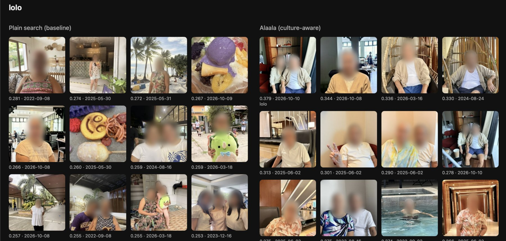
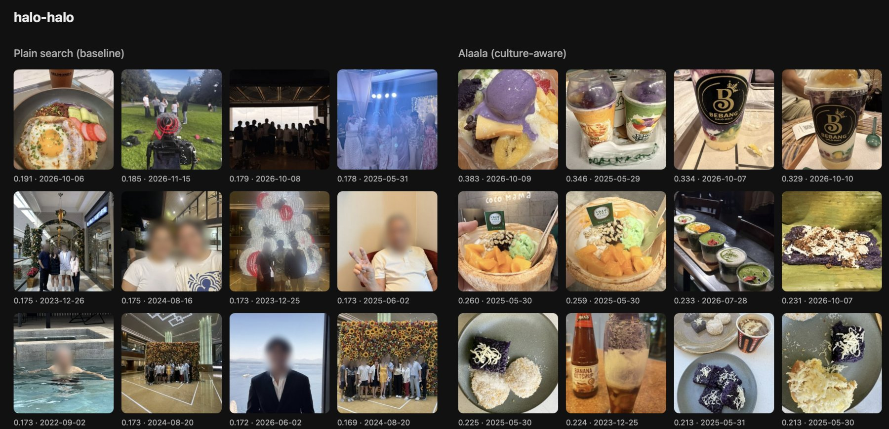
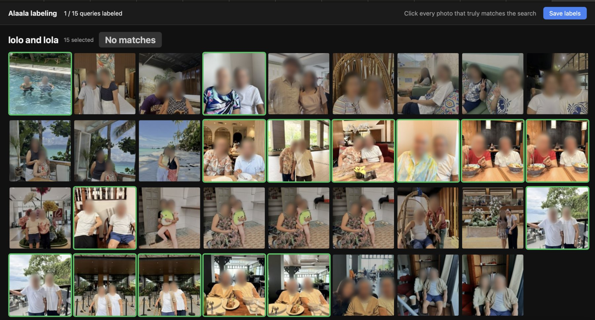

<picture>
  <source media="(prefers-color-scheme: dark)" srcset="docs/cover_dark.png">
  
</picture>

# Alaala

**Culture-aware photo search for Filipino families.** Search your photo library the way you actually talk: "lolo," "halo-halo," "lola sa beach."

*Alaala* means "memory" in Tagalog.


*Searching "lolo" (grandfather). Left: plain AI search returns random relatives and food. Right: Alaala. Faces blurred for privacy.*

## The problem

Photo search assumes English. Apple's natural-language search in Photos doesn't support Filipino, and open models like CLIP don't know what "lolo" (grandfather) or "ensaymada" looks like. Searching "lolo" in my own library returned food, beaches, and random relatives. Searching "grandfather" worked fine. The information was there; the language wasn't.


*Apple Photos on the same photos: no results for "lolo" or "lumpia."*

## How it works

Everything runs locally on a Mac. No photos leave the device.

1. **Ingest:** reads the Apple Photos library with `osxphotos` (dates, places, people you've named), using Photos' local previews so it works with Optimize Mac Storage.
2. **Embed:** encodes every photo with Apple's MobileCLIP2-S2 (small enough for an 8GB M2).
3. **Culture layer** (`culture.py`), which turns a Taglish query into something the model understands:
   - **Lexicon:** about 70 Filipino terms mapped to what they *look like* ("halo-halo" → "a shaved ice dessert with purple ube ice cream, beans and fruit"), averaged as a prompt ensemble
   - **Kinship mapping:** "lolo" and "tita" link to the actual people named in Photos, and those photos get a ranking boost
   - **Holiday windows:** "noche buena" and "simbang gabi" limit results to those dates
4. **Search:** cosine similarity plus boosts and filters, shown as a thumbnail grid. `--compare` shows baseline vs Alaala side by side.

## Results


*"halo-halo": plain search finds nothing relevant; Alaala finds the halo-halo, plus related Filipino desserts further down.*

I wrote and labeled the queries from my own library (434 photos and videos). Each query's candidates were pooled from both methods and shown in shuffled order, so I couldn't tell which method found what.


*The labeling tool: click every photo that truly matches. Candidates come from both methods, shuffled by date.*

**Held-out test set** (14 queries written after all tuning was frozen):

| Query type | Method | nDCG@10 | Recall@10 | Hit@1 |
|---|---|---|---|---|
| Filipino terms (9) | Baseline (plain CLIP) | 0.354 | 0.357 | 0.333 |
| Filipino terms (9) | **Alaala** | **0.512** | **0.592** | **0.444** |
| English (5) | Baseline | 0.627 | 0.571 | 0.600 |
| English (5) | Alaala | 0.627 | 0.571 | 0.600 |

- **+45% nDCG@10 and +66% Recall@10 on Filipino queries**, with **no change on English queries**. The culture layer only steps in when it recognizes a term.
- On the dev set (29 queries used during development), Filipino nDCG went from 0.36 to 0.67. The drop from dev to test is the overfitting a held-out set exists to catch.

### What I tried

| Experiment | Dev nDCG | Test nDCG | Takeaway |
|---|---|---|---|
| v1: replace terms with visual descriptions | 0.684 | 0.553 | Big win for words CLIP doesn't know (lolo, halo-halo, ensaymada) |
| v2: v1 + keep the original word | 0.680 | 0.574 | Tied on dev, better on test. Helps words CLIP already knows |
| Linking titas in the kinship map | tita: −0.25 → 0.00 | n/a | Generic descriptions ("a middle-aged woman") need real identities |

### Error analysis

- **Words the model already knows** (lumpia, pancit, red hotdog): swapping them for descriptions threw away signal. Fix: keep the original word for those terms.
- **Brands** (Fruitas): CLIP partly reads logos, so the brand name beats any description.
- **pancit** still loses on the test set. I left it as a known gap instead of tuning on test data.

### Limitations

One family's library, one annotator, small query sets (29 dev, 14 test), and labels pooled from the top 20 of each method (so recall is relative to what either method found). Treat the numbers as a strong signal, not a benchmark.

## How it relates to Apple Photos

Alaala is a **separate search tool** that reads your Apple Photos library. It doesn't change what the search bar inside the Photos app returns. You search in Alaala, and it shows you the matching photos.

`tag.py` closes that gap. It writes Alaala's matches back into Photos as **keywords** (every halo-halo photo gets tagged "halo-halo"). The Photos search bar searches keywords, and keywords sync through iCloud Photos, so the native search on your Mac and iPhone starts finding them. Nothing is written until you approve it on a review page, every tagged photo also gets an "Alaala" keyword, and `python tag.py --undo` removes everything it added.

The cutoff for "close enough to tag" is calibrated from the eval labels (`tag.py --calibrate`), scoring only photos that were actually reviewed. On my library no cutoff reached 85% precision, which is exactly why tags go through human review before anything is written: zero-shot similarity is good for ranking, but not precise enough for unattended tagging.

**Who can use it today:** anyone on a Mac who's comfortable running a few Terminal commands. Clone the repo, point it at your own Photos library, and add your family's names to the kinship file. Nothing is uploaded anywhere.

## The app

Double-click **Alaala.app** for a native Mac window: type a search, flip on **Compare** to see plain search next to Alaala, click photos to select them, and hit **Tag in Photos**. "Photos ↗" on any result jumps to it in the Photos app. It runs entirely on your Mac (a local server on 127.0.0.1 plus a native window via pywebview).

## Run it

```bash
uv venv --python 3.12 && source .venv/bin/activate
uv pip install -r requirements.txt

python ingest.py --library "/path/to/Library.photoslibrary"
python embed.py
python search.py "lolo" --compare
python make_app.py              # caches thumbnails and builds Alaala.app (double-click it)

# tag photos so the Photos app's own search finds them
python tag.py --calibrate       # optional, uses your eval labels
python tag.py                   # review proposed tags, then "Save approved tags"
python tag.py --apply           # writes keywords (Photos open on the same library)
python tag.py --undo            # removes everything Alaala added

# evaluation
python label.py                 # click the correct photos per query
python eval.py --out dev
```

Copy `config/kinship.example.yaml` to `config/kinship.yaml` and link family members to people named in Photos. Add words in `config/lexicon.yaml`.

## Privacy

Photos, embeddings, names, and labels stay in `data/` and are git-ignored. Your real `config/kinship.yaml` is git-ignored too; the repo ships a blank example.

## Roadmap

- Mac app with a search box and a "Tag in Photos" button (no Terminal)
- Public demo with openly licensed photos
- Audio for videos (detecting actual singing at a videoke)
- More cultures: halmeoni, abuela, bà
